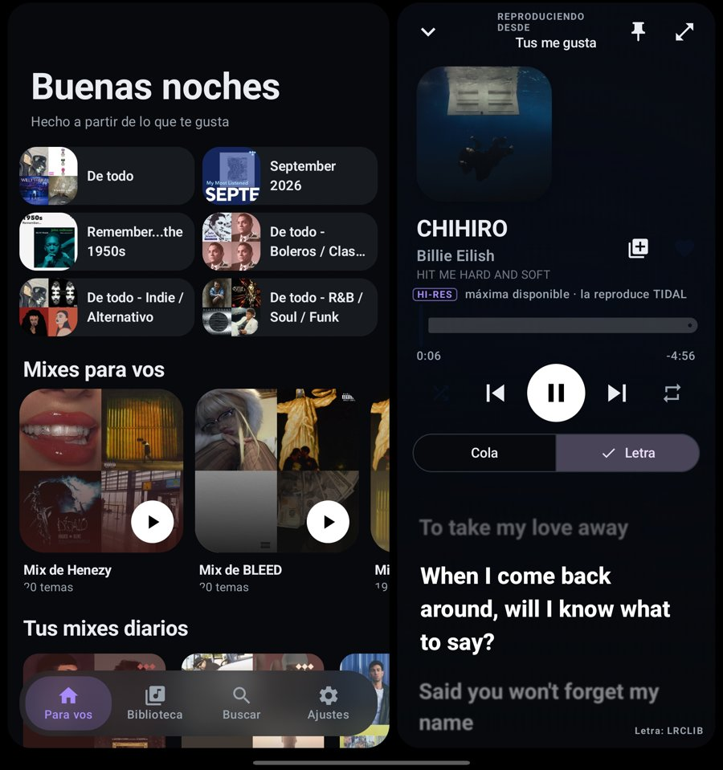
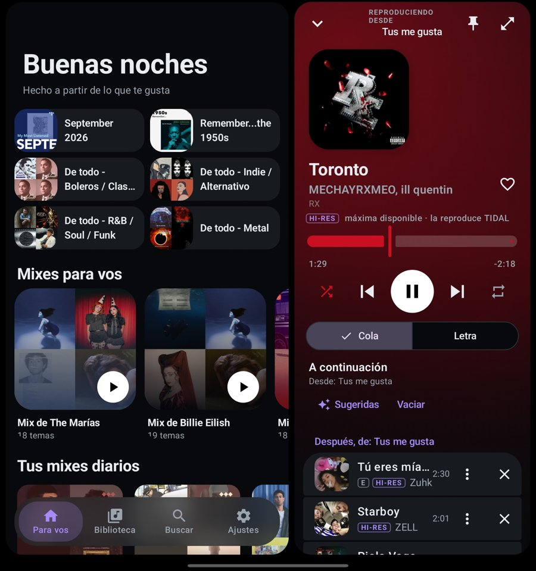
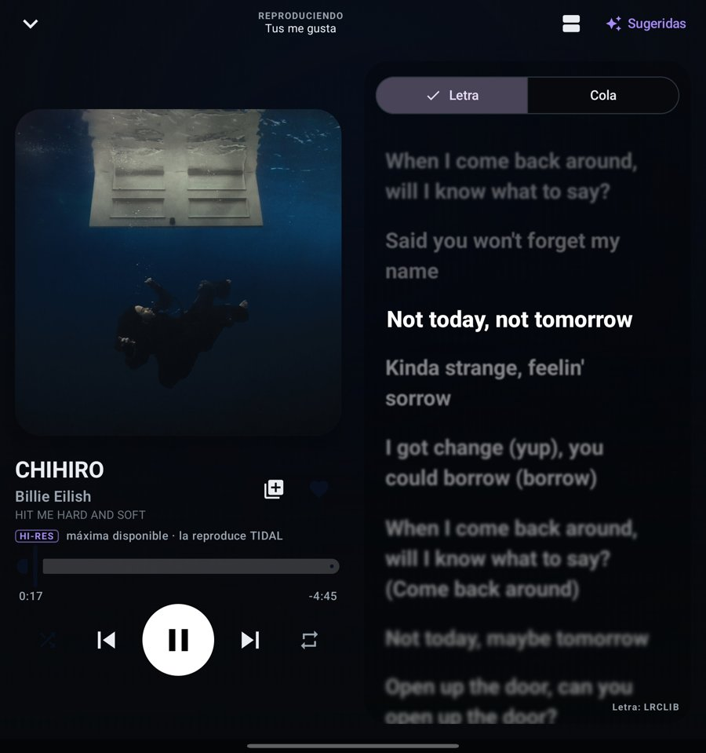
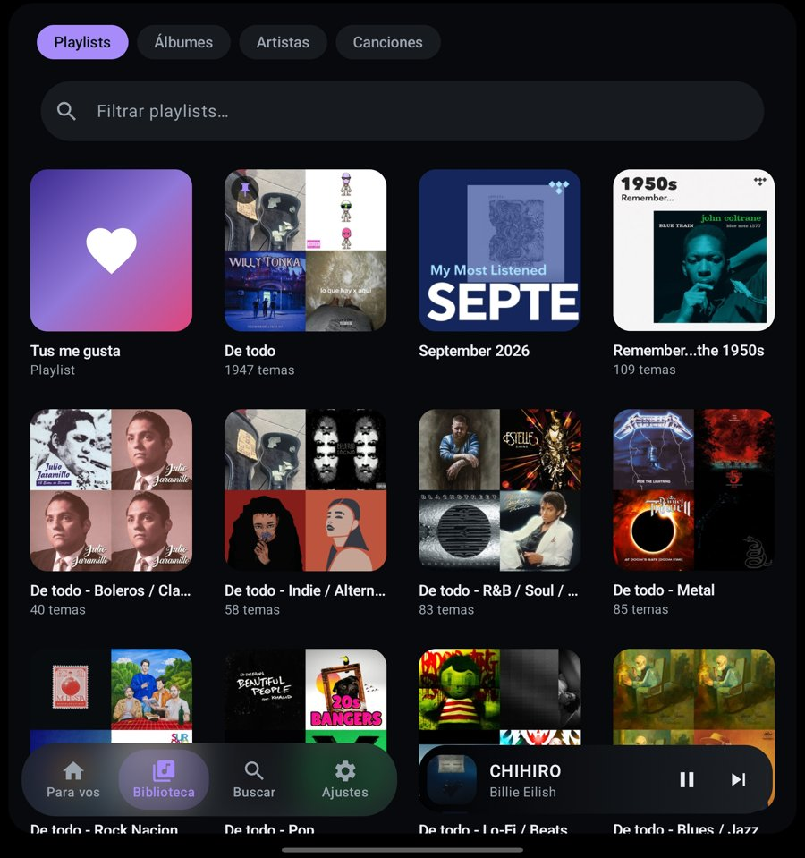
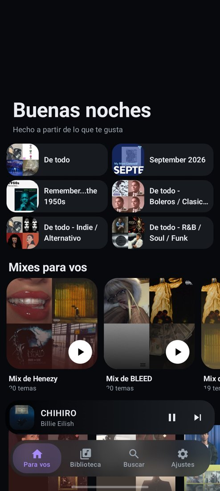
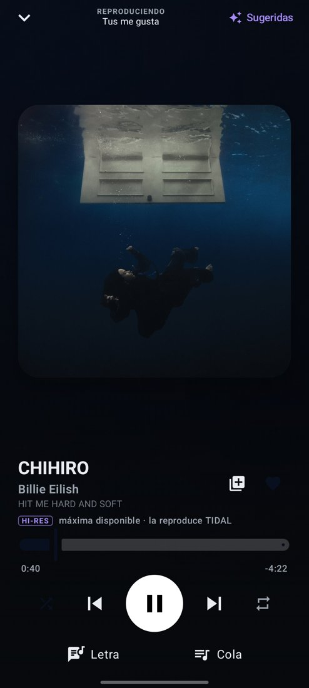

# Marea Link

**Un reproductor para TIDAL pensado para plegables (Galaxy Z Fold), con la cara que la app oficial no tiene.**
*[English below](#english)*

> ⚠️ Proyecto personal **no oficial**. No tiene relación con TIDAL ni con Samsung. Necesitás una suscripción de TIDAL y la app oficial instalada.

<p align="center">
  
</p>
<p align="center">
  
  
  
</p>
<p align="center">
  
  <br>
  <sub>Con el teléfono cerrado</sub>
</p>

## Qué es

Marea Link es una interfaz alternativa para TIDAL. **No reproduce audio por su cuenta**: la que suena es la app oficial de TIDAL, en segundo plano, y Marea la maneja (como un widget o un reloj que controla la música). Por eso tenés catálogo completo, la calidad de tu plan y las descargas de la app oficial, pero con otra interfaz y otra cola.

¿Por qué así? La API pública de TIDAL solo deja reproducir **previews de 30 segundos** a las apps de terceros. Controlar la app oficial es la única forma de escuchar temas completos sin hacer nada turbio (no se toca el DRM, no se modifica la app de TIDAL, no se baja audio).

## Qué tiene

- **Pantalla abierta de verdad**: biblioteca a la izquierda y reproductor al costado (estilo Spotify), panel que se minimiza deslizando hacia abajo, parte de arriba fijable o scrolleable.
- **Modo carpa / libro** (plegado a 90°): arriba la tapa, la letra o la cola; abajo los controles, con animaciones.
- **Cola propia** estilo Spotify: "Agregar a la cola" va primero, aleatorio sobre la playlist entera (aunque tenga miles de temas), reordenar arrastrando, deslizar para quitar o subir a "a continuación". Se guarda si Android cierra la app.
- **Letras sincronizadas** (vía [LRCLIB](https://lrclib.net)), con la línea activa resaltada; tocar una línea salta a ese momento.
- **Inicio** con tus playlists, mixes y recomendaciones de TIDAL.
- **Gestos**: deslizar la tapa para cambiar de tema, doble toque para "me gusta".
- **Widget** estilo One UI con fondo de vidrio, transparencia y colores configurables.
- **Botones de los auriculares/reloj** controlan la cola de Marea (ver más abajo).
- Me gusta, agregar a playlists (también desde el reproductor), crear playlists, **anclar playlists** arriba de todo, **buscar dentro de una playlist**, sugerencias y radio de artista.
- Menú del tema en el reproductor (⋮ o mantener apretada la tapa): ir al álbum o al artista, compartir, radio.
- Calidad del tema según el nivel de TIDAL (Lossless 16-bit · 44.1 kHz, Hi-Res 24-bit hasta 192 kHz).

## Limitaciones (leelas antes)

- Depende de que la app de TIDAL acepte comandos de reproducción por búsqueda (`playFromSearch`). **Funciona hoy**; si TIDAL lo cambia en una actualización, se puede romper.
- Puede haber un corte cortito entre temas, porque Marea le pide a TIDAL el siguiente.
- **Apagá la reproducción automática en TIDAL** (en los ajustes de reproducción de TIDAL) o TIDAL va a meter sus sugerencias en medio de tu cola.
- La calidad real del stream no se puede leer desde afuera: Marea muestra "máxima disponible", la que decida TIDAL según tu plan y tu configuración.
- Las descargas son las de la app oficial; Marea no descarga nada.
- **Funciona en cualquier Android 10 o más nuevo**, plegable o no. En un celular común se usa el diseño de pantalla cerrada (el mismo de la pantalla de afuera del Fold); en tablets, el de pantalla abierta. Los modos carpa/libro solo existen en plegables. Probado únicamente en un Galaxy Z Fold 7: en marcas que cierran apps en segundo plano de forma agresiva (Xiaomi, Huawei, etc.) puede hacer falta sacar a Marea de la optimización de batería.

## Instalación

### 1. Bajá el APK

Bajá el último `MareaLink-vX.Y.Z.apk` de [Releases](https://github.com/tuijack34/MareaLink/releases/latest). No hace falta compilar nada.

### 2. Conseguí tu Client ID de TIDAL (5 minutos, una sola vez)

La primera vez que abrís la app te lo pide y te explica los pasos. Cada persona usa el suyo:

1. Entrá a [developer.tidal.com](https://developer.tidal.com), iniciá sesión con tu cuenta y creá una app.
2. En **Redirect URIs** agregá exactamente: `tidalfold://link`
3. Activá estos **scopes**:
   `user.read` `collection.read` `collection.write` `playlists.read` `playlists.write` `playback` `search.read` `recommendations.read` `entitlements.read`
4. Copiá el **Client ID** y pegalo en la app. El Client Secret no hace falta: no lo pongas en ningún lado.

### 3. Instalá y dale permisos

1. Instalá el APK. **Play Protect** puede bloquearlo porque la app pide acceso a notificaciones (lo necesita para poder controlar TIDAL). Buscá la opción para instalar igual en el aviso o pausá Play Protect un momento desde Play Store.
2. Abrí Marea Link, pegá tu Client ID e iniciá sesión con TIDAL.
3. La app te va a pedir **acceso a notificaciones**. Android lo marca como "ajuste restringido" en apps instaladas a mano:
   - Andá a Ajustes → Aplicaciones → Marea Link → ⋮ (arriba a la derecha) → **Permitir ajustes restringidos**.
   - Después volvé y activá Marea Link en "Acceso a notificaciones".
4. Abrí TIDAL una vez y apagá el Autoplay.

¿Por qué acceso a notificaciones? Es el permiso que Android exige para ver y controlar los reproductores de otras apps (`MediaSessionManager`). Marea **no lee tus notificaciones**: solo busca la sesión de música de TIDAL.

## Controlar el TIDAL de la PC (beta)

Con **Marea PC** (Windows 10/11) podés manejar desde Marea el TIDAL de escritorio: play/pausa, siguiente, anterior, adelantar, aleatorio, repetir, ver la tapa y la letra sincronizada de lo que suena en la computadora.

1. Bajá `MareaPC.exe` de [Releases](https://github.com/tuijack34/MareaLink/releases/latest) y abrilo. Queda como un ícono al lado del reloj (clic derecho → "Iniciar con Windows" si lo querés siempre).
2. La primera vez Windows pregunta por el **firewall**: permitilo en **redes privadas**. Si tu wifi está marcada como "pública", cambiala a privada o no te va a encontrar.
3. En Marea: **Ajustes → Tu PC → Buscar mi PC**, elegila y poné el código de 4 números que muestra el ícono (clic derecho).
4. Con el botón de dispositivos del reproductor elegís si controlás el teléfono o la PC.

Funciona con lo que Windows expone de cualquier reproductor (los mismos controles que las teclas multimedia), así que la cola y elegir temas siguen siendo los de TIDAL de escritorio. Los dos tienen que estar en la misma red.

## Compilarlo vos

Necesitás JDK 21 y el SDK de Android (lo más fácil: [Android Studio](https://developer.android.com/studio)).

```bash
git clone https://github.com/tuijack34/MareaLink.git
cd MareaLink
cp local.properties.example local.properties   # opcional: tu tidal.clientId y tu firma
./gradlew assembleRelease
```

El APK queda en `app/build/outputs/apk/release/`. Si no ponés Client ID, la app lo pide al abrirse; si no configurás firma propia, se firma con tu clave de debug.

## Botones de los auriculares

TIDAL solo conoce el tema que está sonando, así que el botón "siguiente" de los auriculares no sabría qué sigue en la cola de Marea. Para resolverlo, Marea reproduce **silencio digital** (ceros, no se oye nada) y así Android le manda a Marea los botones de los auriculares. Efectos secundarios: vas a ver dos notificaciones de música, y con algunos auriculares Bluetooth puede gastarse un poco más de batería en pausa (se apaga solo a los 15 minutos). Se desactiva en Ajustes → "Botones de los auriculares".

## Cómo está hecho

Kotlin + Jetpack Compose (Material 3), [TIDAL Auth SDK](https://github.com/tidal-music/tidal-sdk-android) para el login (OAuth con PKCE), la API JSON:API de TIDAL (`openapi.tidal.com/v2`) para biblioteca y búsqueda, `MediaController` para manejar la app oficial, Glance para el widget, [Haze](https://github.com/chrisbanes/haze) para el desenfoque y Jetpack WindowManager para las posturas del plegable.

Archivos principales:
- `PlayerController.kt`: conexión con TIDAL, cola propia, detección de fin de tema.
- `HeadsetService.kt`: el puente de los botones de los auriculares.
- `TidalApi.kt`: cliente de la API de TIDAL.
- `ui/`: toda la interfaz (`AppRoot.kt` arma el diseño de pantalla abierta y cerrada).

Hay una pantalla de **Diagnóstico** (en Ajustes) con un registro que podés copiar si algo falla. Pegalo en el issue.

## Licencia

[MIT](LICENSE). TIDAL es una marca de TIDAL Music AS. Este proyecto no está afiliado ni respaldado por TIDAL.

---

## English

**An unofficial TIDAL front-end built for foldables (Galaxy Z Fold).**

Marea Link **does not play audio itself**. It remote-controls the official TIDAL app through Android's standard media-session APIs, the same way a smartwatch or a media widget does. You keep the full catalog, your plan's quality and the official app's downloads, with a different UI and a different queue. The reason: TIDAL's public API only lets third-party apps play 30-second previews. This approach does not touch DRM, does not modify the TIDAL app and does not download audio.

**Features:** two-pane unfolded layout, tabletop and book posture modes, a Spotify-style queue with "play next" and shuffle across whole playlists, synced lyrics (LRCLIB), TIDAL recommendations, gestures, a One UI style widget, and headset button support.

**Limitations:** it relies on TIDAL accepting `playFromSearch`, which may break with a TIDAL update. Expect a small gap between tracks. Turn off TIDAL's Autoplay. Actual stream quality can't be read from outside the TIDAL app. Works on any Android 10+ phone (regular phones get the cover-screen layout, tablets the unfolded one); posture modes need a foldable. Only tested on a Galaxy Z Fold 7.

**Setup:**
1. Download the latest APK from [Releases](https://github.com/tuijack34/MareaLink/releases/latest), or build it with `./gradlew assembleRelease` (JDK 21 + Android SDK).
2. Create an app at [developer.tidal.com](https://developer.tidal.com). Add the redirect URI `tidalfold://link` and enable the scopes listed above.
3. Open Marea Link, paste your Client ID when asked and log in.
4. Allow restricted settings (App info → ⋮ → Allow restricted settings), then grant notification access. That permission is required to control other apps' media sessions; notifications are not read.

The UI is in Spanish (Rioplatense). PRs for translations are welcome.

MIT licensed. TIDAL is a trademark of TIDAL Music AS. This project is not affiliated with or endorsed by TIDAL.
